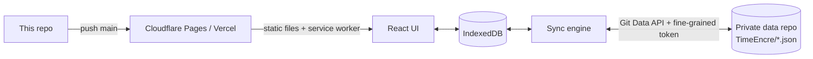

# TimeEncre

**English** · [简体中文](README.zh-CN.md)

A single-user time logger in the style of A Time Logger 2 — static PWA, data synced to your own private GitHub repo.

[](LICENSE)
[](https://timeencre.pages.dev)

Live: <https://timeencre.pages.dev> — an empty shell: whatever you record there stays in your own browser.

## Contents

- [Why TimeEncre?](#-why-timeencre)
- [Highlights](#-highlights)
- [Quick Start](#-quick-start)
- [Deployment](#-deployment)
- [Usage](#-usage)
- [Configuration](#-configuration)
- [Update & Maintenance](#-update--maintenance)
- [How It Works](#-how-it-works)
- [Project Structure](#-project-structure)
- [Development](#-development)
- [Security](#-security)
- [Limitations](#-limitations)
- [Documentation](#-documentation)
- [License](#-license)

## 💡 Why TimeEncre?

Time-tracking apps keep your log in their cloud or on one phone. TimeEncre runs entirely in the browser, stores everything in IndexedDB, and syncs it as readable JSON files to a private GitHub repo you own — no server, no account.

- ✅ Good fit: one person logging their whole day across several devices, who wants to own the raw data.
- ❌ Not a fit: teams, shared projects or billing timesheets — there are no users, roles or sharing. The UI is Chinese and French only.

## ✨ Highlights

- **One-tap timer** — tap an activity tile to start; pause, resume and stop from a dock at the bottom of every page.
- **Calendar history** — a 24-hour timeline per day or week; drag blocks to move or resize them, drag in empty space to backfill.
- **Untracked time you can fix in bulk** — gaps of a minute or more are shown, and one button selects them all to extend the previous block, pull the next one back, or log them as an activity.
- **Statistics and goals** — totals, daily averages, comparison with the previous period, trend lines, sleep rhythm, weekday × hour heatmaps. Goals can be a total ("at least 10 h a week"), a number of days ("sport 4 days a week"), a bedtime ("asleep by 23:30") or a cap on a time slot ("at most 15 min online 22:00–02:00").
- **Weekly review that tells you what to change** — a review built from the week's data: goals hit, biggest changes, plan vs actual, links between your daily 1–5 rating and what you did, and up to three suggestions you can apply in one click.
- **Routines and in-app reminders** — recurring blocks ("weekdays 9:00–12:00 study") drawn on the calendar; while the app is open it reminds you when a cap is near, a session runs too long, a routine starts, or nothing is being timed.
- **Pomodoro that logs itself** — focus (and optionally breaks) become records automatically, settled at the exact end time even if the tab was closed.
- **Keep** — checklists whose items can reserve a time slot shown beside your records.
- **Your data, in Git** — one commit per sync, deterministic JSON, readable diffs; imports A Time Logger 2 backups (`.ttbkp`).
- **Installable and offline** — PWA with an in-app update prompt.

## 🚀 Quick Start

Requires Node.js 22 (see `.node-version`).

```bash
git clone https://github.com/10ta/timeencre.git
cd timeencre
npm install
npm run dev
```

Open http://localhost:5173 — you should see the first-run screen offering to start with common activities, import from A Time Logger 2, restore from a GitHub data repo, or start from scratch.

## 🚢 Deployment

A pure static site: no backend, no environment variables. Every push to `main` redeploys. The same build works at a root domain or any sub-path (`base: './'` in `vite.config.ts`), and uses hash routes (`#/history`), so no rewrite rules are needed.

> [!IMPORTANT]
> When Vercel or Cloudflare asks to install its GitHub App, choose **Only select repositories** and pick **this code repo only**. Never grant it your private data repo — deployment doesn't need it, and granting it lets a third party read your data.

| Setting | Value |
|---|---|
| Build command | `npm run build` |
| Output directory | `dist` |
| Node.js | 22 (read from `.node-version` and `package.json` `engines`) |
| Environment variables | none |

### Cloudflare Pages

1. **Workers & Pages → Create → Pages → Connect to Git**, select this repo.
2. Production branch `main`, framework preset **Vite** (or **None**), then the build command and output directory from the table above.
3. **Save and Deploy**. The site appears at `<project>.pages.dev`.
4. Optional: **Custom domains**. If the build log shows a Node version below 22, add the variable `NODE_VERSION` = `22`.

### Vercel

1. **Add New… → Project**, import this repo.
2. Framework preset **Vite**; build command, output directory as above; install command `npm install`.
3. **Deploy**. The site appears at `<project>.vercel.app`.
4. Optional: **Settings → Domains**. `*.vercel.app` is unreliable from mainland China; a custom domain helps.

### Other hosts

- **GitHub Pages / any static host**: publish `dist/`.
- **Your own server** — Caddy, sub-path example:

```caddyfile
example.com {
    handle_path /timeencre/* {
        root * /srv/timeencre/dist
        file_server
    }
}
```

Over plain `http://` (e.g. a LAN IP), logging, stats and sync still work, but browsers block install, offline cache and notifications.

## 🧭 Usage

UI labels below are given as 中文 / Français.

### Start on a new device

On first launch pick one of: **用一套常用活动 / Utiliser des activités courantes** (14 common activities), **从 A Time Logger 2 导入 / Importer depuis A Time Logger 2** (a `.ttbkp` file), **从 GitHub 数据仓库恢复 / Restaurer depuis le dépôt GitHub**, or **自己从头建 / Partir de zéro**.

### Connect your GitHub data repo

1. Create a **private** repo (public ones are refused). It can be shared with other apps; TimeEncre only touches its data directory (default `TimeEncre/`).
2. Create a **fine-grained personal access token**: *Repository access* → only that repo; *Permissions* → `Contents: Read and write`; set an expiry. Don't use a classic token.
3. In the app: **设置 / Réglages → GitHub 同步 / Synchronisation GitHub**, enter `owner/repo` (or the full URL) and the token, click **检查并保存 / Vérifier et enregistrer**.
4. Click **立即同步 / Synchroniser maintenant**. The badge in the top bar shows pending files; with **自动同步 / Synchronisation automatique** on, it syncs by itself.

Each domain has its own browser storage: connect once on the Cloudflare URL and once on the Vercel URL; they then sync through the repo.

### Use a second device

Choose **从 GitHub 数据仓库恢复** on first launch, connect the same repo, then sync. Don't pick the common-activities set first, or you'll end up with two sets of activities.

### Fill in untracked time

On **统计 / Statistiques**, tick **显示未记录时间 / Afficher le temps non enregistré**, then follow the link to **历史 / Historique**. There, **全选未记录 / Tous les trous** selects every gap in the current day / week / month; extend the previous block, pull the next one back, or log them as an activity — all undoable.

### Plan your week and review it

1. **目标 / Objectifs** → **例程 / Routines**: add the blocks you want to keep each week. The timer page then shows what is planned right now, with a one-tap start.
2. On the timer page, rate each day with one tap (😫 … 😄); each face says what it means.
3. On **统计 / Statistiques** in week view, **本周复盘 / Bilan de la semaine** lists suggestions, the week's key facts and links found over the last 8 weeks. Buttons on a suggestion create the matching goal or routine (undoable).

### Get reminded while you work

**设置 → 提醒 / Rappels**: on by default for "at most" goals (80 % and over the limit) and routine starts; add "no timer for N minutes" and per-activity "every N minutes in a row". Reminders only fire while TimeEncre is open (a background tab is fine); allow system notifications there to see them outside the page.

### Back up without GitHub

**设置 → 导出备份（JSON） / Exporter une sauvegarde (JSON)**, and **导入 TimeEncre 备份** to merge one back (newer edits win).

→ Page-by-page details (calendar drag rules, statistics, goals, routines, review, reminders, Pomodoro, Keep, time zones): [docs/GUIDE.md](docs/GUIDE.md) (Chinese).

## 🔧 Configuration

No environment variables or config files. Everything is set in the app:

| Setting | Where it lives | Synced |
|---|---|---|
| Activities, tags, goals, most settings (incl. reminders) | IndexedDB → `TimeEncre/profile.json` | ✅ |
| Routines, daily ratings | IndexedDB → `TimeEncre/daily.json` | ✅ |
| Records / Keep | IndexedDB → `TimeEncre/records/YYYY-MM.json`, `TimeEncre/keep.json` | ✅ |
| Data repo, branch, directory, token | IndexedDB, this device only | ❌ (not in backups either) |
| Language, time zone, 12-hour clock | `localStorage`, this device only | ❌ |
| Pomodoro running state, reminders already shown | this device only | ❌ |

## 🔄 Update & Maintenance

### Update

Run on the machine where you edit the code (not on a server). It fast-forwards from `origin`, runs tests and the build, then pushes; Cloudflare Pages and Vercel deploy in 1–2 minutes.

```bash
./update.sh            # sync → test + build → push
./update.sh --status   # show local vs remote commit only
./update.sh --no-test  # skip tests and build
```

Open tabs show an update prompt once the new service worker is ready.

### Data & backup

The source of truth on each device is IndexedDB; the GitHub repo is the shared copy and its history is your backup. Without sync, export JSON regularly — the settings page warns when the browser hasn't granted persistent storage.

### Uninstall

> [!WARNING]
> Revoking the token stops sync on **every** device using it. Deleting the data repo also deletes any other app's data stored in it — delete only the `TimeEncre/` directory if the repo is shared.

1. On each device: **设置 → 清空本地数据 / Effacer les données locales** (keeps the repo settings), or clear the site's data in the browser.
2. Delete the Cloudflare Pages / Vercel project.
3. Revoke the token under GitHub **Settings → Developer settings → Personal access tokens → Fine-grained tokens**.

## 🧠 How It Works



- **Browser talks to `api.github.com` directly** → no backend to run; the token never leaves the device.
- **Last-writer-wins per item by `updatedAt`, deletes as tombstones** → devices converge without a server; a stopped timer never "comes back to life".
- **Deterministic JSON, one file per month** → no change means no commit, and diffs stay readable.
- **Month file taken from the stored ISO text, not the device time zone** → devices in different zones don't keep moving records between files.
- **Untracked time ignores seams under 1 minute** → Statistics and History always agree.

Full data format and sync rules: [docs/ARCHITECTURE.md](docs/ARCHITECTURE.md) (Chinese).

## 📁 Project Structure

```text
.
├── src/
│   ├── schema/     # Data types (zod) and version migrations
│   ├── db/         # IndexedDB (Dexie), write actions, query hooks
│   ├── sync/       # GitHub API wrapper, file serialization, sync engine
│   ├── io/         # JSON backup, A Time Logger 2 import
│   ├── lib/        # Time zones, gaps, statistics (pure functions)
│   ├── pomodoro/   # Pomodoro state machine and background runner
│   ├── features/   # One folder per page (timer, history, stats, goals, keep…)
│   ├── ui/         # Shared components
│   └── i18n/       # tr(), French dictionary, date formats
├── tests/          # Vitest unit tests (in-memory IndexedDB, fake GitHub)
├── public/         # PWA icons
└── update.sh       # Test, build and push = deploy
```

## 🔨 Development

```bash
npm install
npm run dev       # http://localhost:5173
npm test          # vitest run
npm run build     # tsc --noEmit + vite build → dist/
```

There is no CI and no release tagging: `update.sh` runs the tests and the build before it pushes, and the push is the release. Conventions (i18n, time zones, data changes) are in [AGENTS.md](AGENTS.md).

## 🔒 Security

- The token can read and write the **whole** data repo, not just `TimeEncre/` — fine-grained tokens can't be limited to a directory. Use a repo that holds only data you'd accept TimeEncre having access to, and set an expiry.
- The token is stored unencrypted in the browser's IndexedDB on each device and is never exported in backups. Anyone with access to that browser profile can read it.
- No third-party scripts are loaded; the only network calls are to `api.github.com`.

## 🚧 Limitations

- Single user, no sharing. The UI is Chinese and French.
- Reminders need the app open (a background tab is fine). A closed tab, or a phone that suspended the browser, gets no reminders — there is no push server.
- The weekly review's links compare averages between two groups of days; they show what goes together, not causes, and need at least 4 days per group.
- Data repos with more than ~100,000 entries hit GitHub's tree-listing limit and sync stops with an error.
- Conflict resolution is per item: if two devices edit the same record offline, the later edit wins as a whole (except stopped timers, which stay stopped).
- Device clocks matter: a device whose clock is far off can win or lose merges it shouldn't.

## 📚 Documentation

- [AGENTS.md](AGENTS.md): Commands, conventions, invariants and gotchas for AI coding agents.
- [docs/GUIDE.md](docs/GUIDE.md): Page-by-page user guide — calendar, statistics, Pomodoro, Keep, time zones (Chinese).
- [docs/ARCHITECTURE.md](docs/ARCHITECTURE.md): Data format, repo layout, sync and merge rules, statistics definitions (Chinese).

## 📄 License

[MIT](LICENSE) © 2026 10ta
