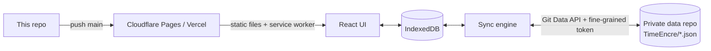

# TimeEncre

[English](README.md) · **简体中文**

仿 A Time Logger 2 的单用户时间记录 App：纯静态 PWA，数据同步到你自己的私有 GitHub 仓库。

[](LICENSE)
[](https://timeencre.pages.dev)

在线地址：<https://timeencre.pages.dev> —— 只是空壳，你在上面记录的内容只保存在你自己的浏览器里。

## 目录

- [为什么是 TimeEncre？](#-为什么是-timeencre)
- [亮点](#-亮点)
- [快速开始](#-快速开始)
- [部署](#-部署)
- [使用](#-使用)
- [配置](#-配置)
- [更新与维护](#-更新与维护)
- [工作原理](#-工作原理)
- [项目结构](#-项目结构)
- [开发](#-开发)
- [安全](#-安全)
- [局限](#-局限)
- [文档地图](#-文档地图)
- [许可](#-许可)

## 💡 为什么是 TimeEncre？

时间记录 App 通常把数据锁在它们的云端或某一台手机里。TimeEncre 完全在浏览器里运行，数据存在 IndexedDB，并以可读的 JSON 文件同步到你自己的私有 GitHub 仓库——没有服务器，也不用注册账号。

- ✅ 适合：一个人在多台设备上记录一整天的时间，并且想自己掌握原始数据。
- ❌ 不适合：团队、共享项目或计费工时——没有用户、角色和共享功能。界面只有中文和法语。

## ✨ 亮点

- **一点即计时**：点活动格子开始；在每个页面底部的悬浮栏里暂停、继续、停止。
- **日历式历史**：按日或按周的 24 小时时间轴；拖动色块改时间或平移，在空白处拖出一段直接补录。
- **未记录时间可批量补**：1 分钟以上的空档都会显示，一个按钮全选，然后延长上一段、提前下一段，或记成某个活动。
- **统计与目标**：总计、日均、和近几周同期比较（只比已经过完的日子，超出往常范围才标出）、趋势线、作息规律、星期 × 小时热力图。目标可以是累计时长（“每周至少学习 10 小时”）、几天达标（“每周运动 4 天”）、按时作息（“23:30 前睡”）或某个时段的上限（“22:00–02:00 上网至多 15 分钟”）。
- **告诉你该改什么的周复盘**：按这一周的数据自动生成：目标达成、变化最大的活动、计划 vs 实际、每日 1–5 分评分和所做之事的关联，以及最多三条可一键落实的建议。
- **例程与 App 内提醒**：每周固定的时间块（“工作日 9:00–12:00 学习”）画在日历上；App 开着时，快到上限、连续太久、例程开始、长时间没计时都会提醒。
- **会自己记账的番茄钟**：专注（可选连休息一起）自动生成记录；即使标签页关了，也按准确的结束时间结算。
- **Keep**：清单里的条目可以预约时间段，显示在记录旁边。
- **数据在 Git 里**：每次同步一个提交，JSON 序列化是确定性的，diff 可读；可导入 A Time Logger 2 备份（`.ttbkp`）。
- **可安装、可离线**：PWA，有新版本时在页面内提示更新。

## 🚀 快速开始

需要 Node.js 22（见 `.node-version`）。

```bash
git clone https://github.com/10ta/timeencre.git
cd timeencre
npm install
npm run dev
```

打开 http://localhost:5173，应看到首次使用的选择页：用一套常用活动、从 A Time Logger 2 导入、从 GitHub 数据仓库恢复，或自己从头建。

## 🚢 部署

纯静态站点：没有后端，也没有环境变量。每次 push 到 `main` 都会重新部署。同一份构建产物可以放在根域名或任意子路径（`vite.config.ts` 里的 `base: './'`），并且用 hash 路由（`#/history`），不需要配置重写规则。

> [!IMPORTANT]
> Vercel 或 Cloudflare 请求安装它们的 GitHub App 时，选 **Only select repositories**，**只勾选这个代码仓库**。不要把私有数据仓库授权给它们——部署用不到，授权了就等于让第三方也能读取你的数据。

| 项目 | 值 |
|---|---|
| 构建命令 | `npm run build` |
| 输出目录 | `dist` |
| Node.js | 22（从 `.node-version` 和 `package.json` 的 `engines` 读取） |
| 环境变量 | 不需要 |

### Cloudflare Pages

1. **Workers & Pages → Create → Pages → Connect to Git**，选中本仓库。
2. 生产分支 `main`，框架预设选 **Vite**（或 **None**），构建命令和输出目录按上表填写。
3. **Save and Deploy**，站点地址为 `<项目名>.pages.dev`。
4. 可选：**Custom domains** 绑定域名。如果构建日志显示 Node 版本低于 22，加一个变量 `NODE_VERSION` = `22`。

### Vercel

1. **Add New… → Project**，导入本仓库。
2. 框架预设 **Vite**；构建命令、输出目录同上；安装命令 `npm install`。
3. **Deploy**，站点地址为 `<项目名>.vercel.app`。
4. 可选：**Settings → Domains** 绑定域名。`*.vercel.app` 在中国大陆访问不稳定，建议绑定。

### 其他托管方式

- **GitHub Pages / 任意静态托管**：发布 `dist/` 即可。
- **自己的服务器**：Caddy 子路径示例：

```caddyfile
example.com {
    handle_path /timeencre/* {
        root * /srv/timeencre/dist
        file_server
    }
}
```

通过 `http://` 访问（例如局域网 IP）时，记录、统计、同步照常可用，但浏览器不允许安装为 App、离线缓存和通知。

## 🧭 使用

下文的界面名称写作“中文 / Français”。

### 在新设备上开始

首次打开时任选其一：**用一套常用活动 / Utiliser des activités courantes**（14 个常用活动）、**从 A Time Logger 2 导入 / Importer depuis A Time Logger 2**（选 `.ttbkp` 文件）、**从 GitHub 数据仓库恢复 / Restaurer depuis le dépôt GitHub**、**自己从头建 / Partir de zéro**。

### 连接 GitHub 数据仓库

1. 建一个**私有**仓库（公开仓库会被拒绝）。可以和其他 app 共用，TimeEncre 只读写其中的数据目录（默认 `TimeEncre/`）。
2. 生成 **fine-grained personal access token**：*Repository access* 只选这个仓库；*Permissions* 只开 `Contents: Read and write`；设置过期时间。不要用 classic token。
3. 在 App 里：**设置 / Réglages → GitHub 同步 / Synchronisation GitHub**，填 `owner/repo`（或完整网址）和令牌，点 **检查并保存 / Vérifier et enregistrer**。
4. 点 **立即同步 / Synchroniser maintenant**。顶栏的徽标显示待同步的文件数；打开 **自动同步 / Synchronisation automatique** 后会自己同步。

每个域名的浏览器存储是独立的：在 Cloudflare 地址和 Vercel 地址上各连接一次，之后两边通过仓库同步。

### 在第二台设备上使用

首次打开选 **从 GitHub 数据仓库恢复**，连接同一个仓库后同步。不要先选“用一套常用活动”，否则会和仓库里的活动并存成两套。

### 补上未记录的时间

在 **统计 / Statistiques** 勾选 **显示未记录时间 / Afficher le temps non enregistré**，点旁边的链接跳到 **历史 / Historique**。在那里，**全选未记录 / Tous les trous** 会选中当前日 / 周 / 月里的全部空档，可以延长上一段、提前下一段，或记成某个活动，都能撤销。

### 计划一周，再复盘

1. **目标 / Objectifs** → **例程 / Routines**：加上每周想固定下来的时间块。计时页随后会显示“现在计划做什么”，点一下就开始。
2. 在计时页每天点一下打分（😫 … 😄），每个表情都写着代表什么感受。
3. 在 **统计 / Statistiques** 的周视图里，**本周复盘 / Bilan de la semaine** 列出建议、本周要点和近 8 周找到的关联。建议旁的按钮会建好对应的目标或例程（可撤销）。

### 边做边提醒

**设置 → 提醒 / Rappels**：默认对“至多”目标（到 80% 和超出时）和例程开始提醒；还可以加“N 分钟没有计时”和按活动的“每连续 N 分钟”。提醒只在 TimeEncre 开着时生效（后台标签页也行）；在那里允许系统通知，就能在页面外看到。

### 不用 GitHub 时备份

**设置 → 导出备份（JSON） / Exporter une sauvegarde (JSON)**；用 **导入 TimeEncre 备份** 合并回来（较新的修改胜出）。

→ 各页面的详细说明（日历拖动规则、统计、目标、例程、复盘、提醒、番茄钟、Keep、时区）：[docs/GUIDE.md](docs/GUIDE.md)。

## 🔧 配置

没有环境变量，也没有配置文件。所有设置都在 App 里：

| 设置 | 存在哪里 | 是否同步 |
|---|---|---|
| 活动、标签、目标、大部分设置（含提醒） | IndexedDB → `TimeEncre/profile.json` | ✅ |
| 例程、每日评分 | IndexedDB → `TimeEncre/daily.json` | ✅ |
| 记录 / Keep | IndexedDB → `TimeEncre/records/YYYY-MM.json`、`TimeEncre/keep.json` | ✅ |
| 数据仓库、分支、目录、令牌 | IndexedDB，仅本设备 | ❌（也不进备份） |
| 语言、时区、12 小时制 | `localStorage`，仅本设备 | ❌ |
| 番茄钟的运行状态、已经提醒过的事 | 仅本设备 | ❌ |

## 🔄 更新与维护

### 更新

在你改代码的电脑上运行（不是服务器）。脚本会从 `origin` 快进拉取、跑测试和构建，然后推送；Cloudflare Pages 和 Vercel 一两分钟内完成部署。

```bash
./update.sh            # sync → test + build → push
./update.sh --status   # show local vs remote commit only
./update.sh --no-test  # skip tests and build
```

新版本的 service worker 就绪后，已打开的页面会提示刷新。

### 数据与备份

每台设备上的数据以 IndexedDB 为准；GitHub 仓库是共享副本，它的提交历史就是备份。不用同步的话请定期导出 JSON——浏览器没有授予持久存储时，设置页会提醒。

### 卸载

> [!WARNING]
> 吊销令牌会让**所有**使用它的设备停止同步。删除数据仓库会连带删除其他 app 存在里面的数据——仓库是共用的话，只删 `TimeEncre/` 目录。

1. 每台设备上：**设置 → 清空本地数据 / Effacer les données locales**（仓库设置会保留），或在浏览器里清除该网站的数据。
2. 删除 Cloudflare Pages / Vercel 上的项目。
3. 在 GitHub **Settings → Developer settings → Personal access tokens → Fine-grained tokens** 吊销令牌。

## 🧠 工作原理



- **浏览器直连 `api.github.com`** → 不需要后端；令牌不离开设备。
- **每条数据按 `updatedAt` 较新者胜出，删除以墓碑形式传播** → 不需要服务器，各设备也能收敛到同一结果；已停止的计时不会“复活”。
- **确定性的 JSON，按月份分文件** → 没有改动就没有提交，diff 保持可读。
- **月份取自存储的 ISO 时间文本，而不是设备时区** → 不同时区的设备不会把记录在文件之间来回搬。
- **未记录时间忽略 1 分钟以内的接缝** → 统计页和历史页的数字总能对上。

完整的数据格式和同步规则：[docs/ARCHITECTURE.md](docs/ARCHITECTURE.md)。

## 📁 项目结构

```text
.
├── src/
│   ├── schema/     # Data types (zod) and version migrations
│   ├── db/         # IndexedDB (Dexie), write actions, query hooks
│   ├── sync/       # GitHub API wrapper, file serialization, sync engine
│   ├── io/         # JSON backup, A Time Logger 2 import
│   ├── lib/        # Time zones, gaps, statistics (pure functions)
│   ├── pomodoro/   # Pomodoro state machine and background runner
│   ├── features/   # One folder per page (timer, history, stats, goals, keep…)
│   ├── ui/         # Shared components
│   └── i18n/       # tr(), French dictionary, date formats
├── tests/          # Vitest unit tests (in-memory IndexedDB, fake GitHub)
├── public/         # PWA icons
└── update.sh       # Test, build and push = deploy
```

## 🔨 开发

```bash
npm install
npm run dev       # http://localhost:5173
npm test          # vitest run
npm run build     # tsc --noEmit + vite build → dist/
```

没有 CI，也不打版本 tag：`update.sh` 在推送前跑测试和构建，推送即发布。开发约定（多语言、时区、数据结构改动）见 [AGENTS.md](AGENTS.md)。

## 🔒 安全

- 令牌能读写**整个**数据仓库，而不只是 `TimeEncre/`——fine-grained token 无法限定到目录。请只在你愿意让 TimeEncre 访问的仓库里使用，并设置过期时间。
- 令牌以明文存在每台设备浏览器的 IndexedDB 里，不会随备份导出。能使用这个浏览器配置文件的人都能读到它。
- 不加载任何第三方脚本；唯一的网络请求是 `api.github.com`。

## 🚧 局限

- 单用户，不能共享。界面只有中文和法语。
- 提醒需要 App 开着（后台标签页也行）。标签页关了、或手机把浏览器挂起时没有提醒——没有推送服务器。
- 周复盘的关联是比较两组日子的平均值，只说明一起出现，不说明原因；每组至少要 4 天。
- 数据仓库超过约 10 万个条目时，GitHub 返回的目录列表会被截断，同步会报错停止。
- 冲突按条目解决：两台设备离线时改了同一条记录，较晚的修改整条胜出（已停止的计时例外，保持停止）。
- 设备时钟会影响结果：时钟偏差很大的设备，可能在合并时赢或输了不该赢或输的修改。

## 📚 文档地图

- [AGENTS.md](AGENTS.md)：给 AI 编码代理的命令、约定、不变量和坑（英文）。
- [docs/GUIDE.md](docs/GUIDE.md)：按页面的使用手册——日历、统计、番茄钟、Keep、时区。
- [docs/ARCHITECTURE.md](docs/ARCHITECTURE.md)：数据格式、仓库布局、同步与合并规则、统计口径。

## 📄 许可

[MIT](LICENSE) © 2026 10ta
